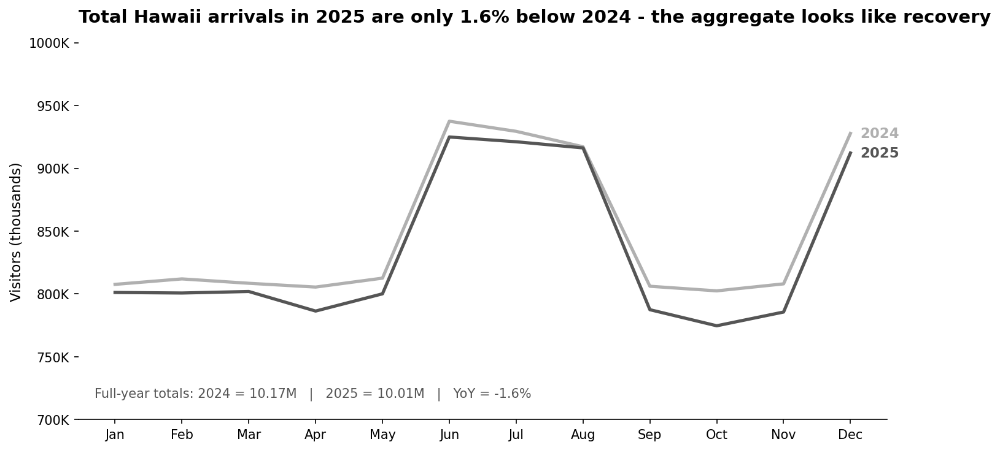
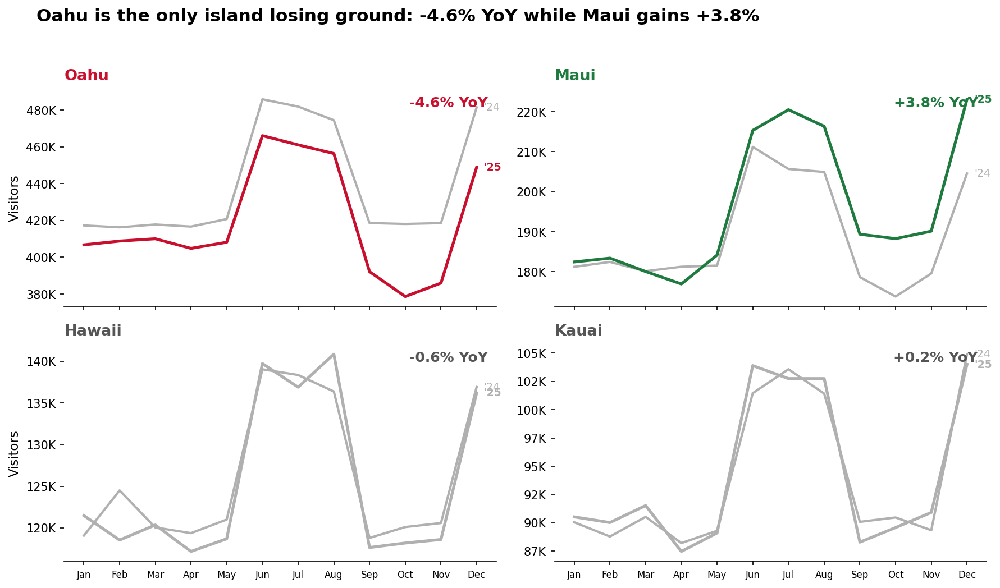
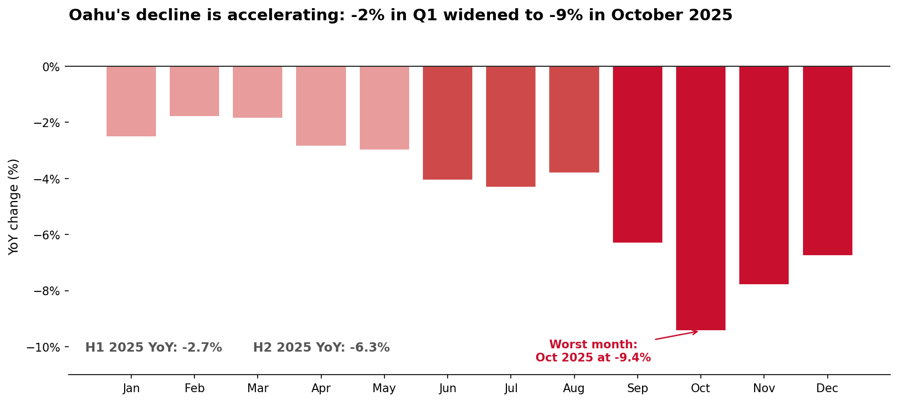
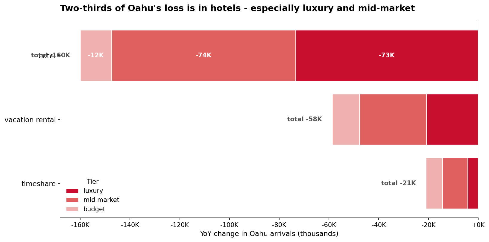
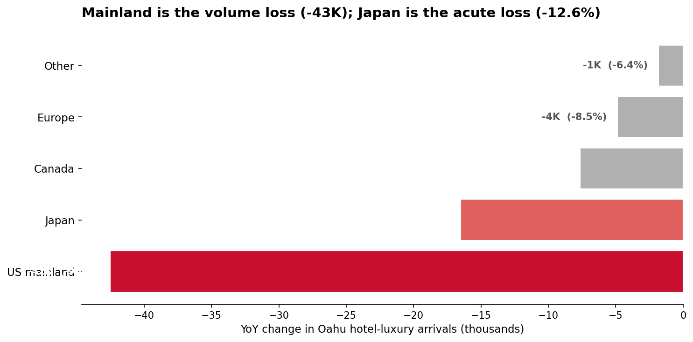
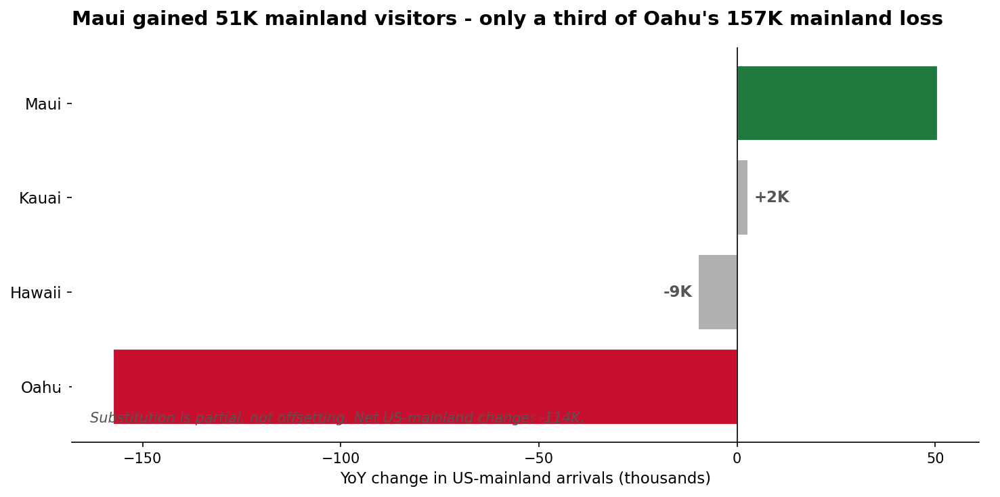
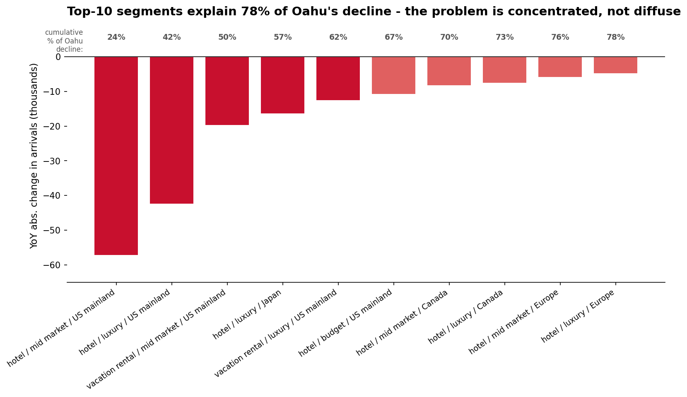

# The recovery is not done. It is done on Maui. Oahu is still losing visitors, the decline is accelerating, and 78% of the loss concentrates in 10 targetable hotel segments.

*Prepared for: Director, Tourism Authority | Prepared by: Analytics team | Date: 2026-04-18*

## Executive summary

The headline number supports the "recovery is done" message at the island-chain level: total 2025 arrivals came in at 10.01M versus 10.17M in 2024, a 1.6% dip that is well within normal year-over-year noise.

**That number is misleading.** Underneath the aggregate, only Maui has actually recovered (+3.8% YoY). Oahu lost 240,000 visitors versus 2024 (-4.6% YoY) and its decline is accelerating: -2.7% in the first half of 2025 worsened to -6.3% in the second half, with October 2025 the single worst month in the dataset at -9.4%. Hawaii (Big Island) and Kauai are flat. If Oahu were simply holding level with 2024, the state as a whole would be in net growth right now - regional offices' complaints are a direct consequence of that arithmetic.

The problem is not spread thinly across Oahu. **Seventy-eight percent of Oahu's decline comes from just ten specific segments** (out of 45 possible combinations of accommodation type, tier, and origin market). Two-thirds of the loss is in hotels - particularly the luxury and mid-market hotel tiers. Within Oahu hotel-luxury, US-mainland travelers account for the largest absolute drop while Japanese luxury-hotel visitors have fallen 12.6% - a decline that is uniquely an Oahu problem since Japanese luxury-hotel arrivals to the other three islands are flat or up slightly.

**Top recommendation:** revise the authority's public "recovery complete" messaging this quarter, and stand up a focused Oahu hotel recovery task force targeting the ~10 concentrated cells behind the decline. Three additional recommendations (ranked) are detailed at the end of this report.

---

## Context: the aggregate supports the recovery narrative

Looking only at the state-wide total, the argument that recovery is complete is defensible. Total 2025 arrivals of 10.01M came in 1.6% below 2024's 10.17M, which is within normal YoY noise. Month-to-month shape looks nearly identical across the two years - the seasonal peaks in summer and December remain the peaks.

This is the number the director has been using. It is arithmetically correct. But it is an average that masks substantial divergence underneath, which is why regional offices are pushing back.

---

## Tension: the aggregate hides a four-way split

As soon as we break the total out by island, the recovery narrative fractures. Maui is up 3.8% YoY. Kauai and Hawaii (Big Island) are essentially flat, within +/- 1%. Oahu alone is down 4.6% - a loss of roughly 240,000 visitors versus 2024.

Two of the four islands are moving in the opposite direction from the aggregate. **Oahu's YoY decline (-240K) is larger in absolute terms than the state-wide total decline (-162K).** Put differently: without Oahu's problem, the rest of the portfolio would be in net growth. Regional offices on Oahu and on the other neighbor islands are complaining for different reasons, but both groups are reading the data more honestly than the aggregate does.

### The Oahu decline is worsening, not stabilizing

A common retort to a regional dip is "it's normalizing" or "it's a one-off month." That is not what the Oahu data shows. Monthly YoY on Oahu ran -2% to -3% through Q1 2025, widened to -4% through summer, and hit -9% in October.

The second half of 2025 on Oahu was -6.3% YoY versus -2.7% in the first half. Seasonal shape is intact (peaks are still peaks), so this is a *level* shift, not a timing change. Whatever is happening on Oahu, it was getting worse through the year we just closed, which means waiting for it to correct itself is the riskiest option.

---

## Root cause: where on Oahu the problem actually lives

### Two-thirds of Oahu's loss is in hotels

Breaking Oahu's 240K-visitor decline down by accommodation type and tier shows very uneven distribution. Hotels account for 160K of the loss - 67% of the island's shortfall. Within hotels, the luxury tier lost 73K visitors (-10.1% YoY) and the mid-market tier lost 74K (-4.6% YoY). Vacation rentals and timeshare declined much less, and budget-tier hotels were nearly flat.

### Inside Oahu hotel-luxury: two distinct stories by origin market

Drilling one more level - Oahu hotel-luxury by origin market - surfaces two different problems, not one.

- **US mainland** is the single largest absolute loss in Oahu hotel-luxury (-42,500 visitors, 58% of the hotel-luxury decline). At -9.8% YoY, it is deeper than the aggregate Oahu decline.
- **Japan** is the *proportionally* deepest loss at -12.6% YoY. That drop does not show up on other islands - Japan hotel-luxury is flat on Kauai, up on Maui, and only slightly down on Hawaii. Whatever is reducing Japanese luxury-hotel travel to Hawaii is an Oahu-specific effect. Waikiki product mix, a specific property closure, competitive Asia-Pacific destinations, or yen-related affordability are plausible candidates, but the data cannot distinguish them.

### Maui is absorbing about a third of what Oahu is losing - but only a third

It is tempting to see Maui's +3.75% YoY as a wash against Oahu's -4.55%. It is not. Maui's US-mainland gain of ~51K is roughly a third of Oahu's US-mainland loss of ~157K. Net mainland arrivals to Hawaii are down 114K.

The pattern is consistent with some Oahu-considering mainland travelers choosing Maui instead, but we cannot prove that from arrivals data alone (that would require a traveler-side survey). What we can say with confidence: the mainland customer is leaving the state's total visitor count more than it is shifting between islands.

### Where to focus: 10 specific segments drive 78% of the Oahu decline

One reason to be cautiously optimistic is that Oahu's problem is concentrated, not diffuse. Of 45 possible (accommodation x tier x origin) combinations on Oahu, just 10 cells account for 78% of the full-year decline. The top 5 alone are 62%.

Concentration matters because it means interventions can be targeted. A broad "save Oahu tourism" campaign would be expensive and poorly aimed. A focused program on Waikiki hotel-luxury and hotel-mid-market, with explicit outreach to US-mainland and Japanese travel trade, can address the majority of the problem.

---

## Recommendations

Ranked by confidence and expected impact. Each carries an owner, success metric, and follow-up date.

| # | Recommendation | Owner | Success metric | Confidence | Follow-up |
|---|---|---|---|---|---|
| R1 | **Revise the authority's public "recovery complete" messaging.** The number is true for Maui and roughly true for Kauai/Hawaii, but materially wrong for Oahu. Adopt a variant along the lines of "recovery is uneven; Maui is leading, Oahu still needs help" and use it consistently in director-level communications and in responses to regional offices. | Director's office (communications) | Updated messaging in place across press, partner briefings, and regional sync decks; regional offices acknowledge the change | High | 2 weeks (May 2026) |
| R2 | **Stand up an Oahu hotel recovery task force** targeting the top-10 cells specifically. Priority segments: hotel-luxury US-mainland (-42.5K), hotel-mid-market US-mainland (-57.3K), hotel-luxury Japan (-16.5K). Tools: co-op marketing with Waikiki operators, rate-plan and package review with the big luxury hotel brands, targeted reactivation of US-mainland travel agents and Japan outbound tour operators. | Head of Oahu region + Head of trade marketing | Stabilize Oahu hotel YoY from -5.5% to within -2% by end of Q2 2026 | High | 6 weeks (June 2026), then monthly |
| R3 | **Commission a 4-week diagnostic on Japan luxury-hotel specifically.** A 12.6% YoY drop concentrated on Oahu, while other islands are flat or up, points to a mechanism we cannot see in arrivals data. Likely candidates: FX/pricing, hotel-product mix (e.g., specific Waikiki property availability), competitor Asia-Pacific destinations, inbound-tour operator sentiment. Commission the trade team to interview 8-12 Japanese outbound travel operators and produce a named-mechanism report. | Head of international markets (Japan desk) | Short diagnostic identifies 1-3 primary mechanisms with recommended next steps | Medium | 4 weeks |
| R4 | **Validate the Maui vs. Oahu substitution hypothesis** before celebrating Maui's gains. Maui's +51K US-mainland lift tracks suspiciously well with Oahu's -157K mainland drop. If those Maui visitors are primarily shifted-from-Oahu rather than new to the state, Maui's "recovery" is partly zero-sum within the portfolio. Field a short attitudinal survey to recent and prospective mainland visitors (n approximately 1,000) asking about island choice and prior trip history. | Research team | Survey fielded; report quantifies share of Maui mainland gains that are shifted from Oahu consideration vs. net-new demand | Medium | 8 weeks |

---

## Appendix

### Methodology

- **Data:** `tourism_monthly.csv` (4,320 rows, fully balanced: 24 months x 4 islands x 3 accommodation types x 3 tiers x 5 origin markets).
- **Comparison:** Full-year 2025 versus full-year 2024 (both complete).
- **Metric:** visitor arrivals (count), aggregated by the relevant groupings.
- **Pipeline:** Six-phase analytical pipeline (Frame -> Explore -> Validate -> Story -> Charts -> Deliver). Intermediate artifacts (`framing.md`, `findings.json`, `validation.md`, `storyboard.md`) are in the same output directory.
- **Reproducibility:** Each chart is generated by `chart_scripts/generate_all_charts.py`. Independent verification scripts for the segmentation, root-cause drill, monthly trend, and Simpson's Paradox check are in `notebooks/`.

### Validation summary

- Every headline number was re-derived by at least two independent methods (pivot table, groupby unstack, and row-filter-sum). All three methods agreed to the integer for aggregate totals and island splits.
- **Simpson's Paradox explicit check:** The aggregate -1.6% YoY masks islands moving in both directions (+3.8% to -4.6%). Two of four islands are opposite-signed from the aggregate. Documented and reframed.
- **Level-2 Simpson check** (inside Oahu): every accommodation-tier cell on Oahu is negative. No opposing direction at this level - the Oahu decline is real and broad *within* Oahu, just concentrated in hotels.
- Parts-sum-to-whole verified at every decomposition level.
- Bias checklist (survivorship, selection, lookahead, composition shift, metric drift, base rate) was worked through with no issues found except the flagged caveats below.
- Full validation log is in `validation.md`.

### Caveats (please read before acting)

1. **Metric scope.** This analysis covers visitor *arrivals* only. Average daily spend, length of stay, hotel occupancy, and ADR are not in the dataset. An arrivals recovery does not guarantee an economic recovery, and vice versa. Any follow-on work on revenue should re-join to tax or occupancy data.
2. **Substitution is inferred, not proven.** The Maui gain vs. Oahu loss in US-mainland arrivals is consistent with travelers shifting between islands but is not direct evidence of it. R4 is proposed specifically to resolve this.
3. **No external signal.** We have no price, capacity, weather, event, or competitor data to attribute a "why" for the Oahu and Japan-luxury declines. R3 is designed to fill that gap on the highest-priority segment.
4. **Two-year panel.** Trend claims (especially the H2 2025 acceleration) are directional. Whether the acceleration continues or reverses into 2026 requires at least one more quarter of data.
5. **Clean/balanced data.** The input has exactly 4,320 rows, with no missing values and every possible combination of dimensions populated. This is unusual for a raw field panel. We are trusting the data provider that the 4,320 cells reflect complete measurement rather than imputation.

### Files produced

- `framing.md` - Phase 1 question framing, hypotheses, success criteria
- `findings.json` - Phase 2 structured findings with scripts and hypothesis status
- `validation.md` - Phase 3 independent re-derivation, Simpson's check, bias checklist
- `storyboard.md` - Phase 4 CTR narrative arc and recommendations with owners
- `charts/` - Phase 5 PNGs (7 charts, action-titled, gray+emphasis color strategy)
- `chart_scripts/generate_all_charts.py` - Phase 5 reproducible chart generator
- `notebooks/01_yoy_by_dimension.py` - YoY breakdowns across all dimensions
- `notebooks/02_oahu_root_cause.py` - Oahu decomposition (accommodation x tier x origin)
- `notebooks/03_oahu_monthly_trend.py` - Oahu month-over-month YoY
- `notebooks/04_simpsons_paradox_check.py` - Explicit Simpson's Paradox check
- `report.md` - This document
