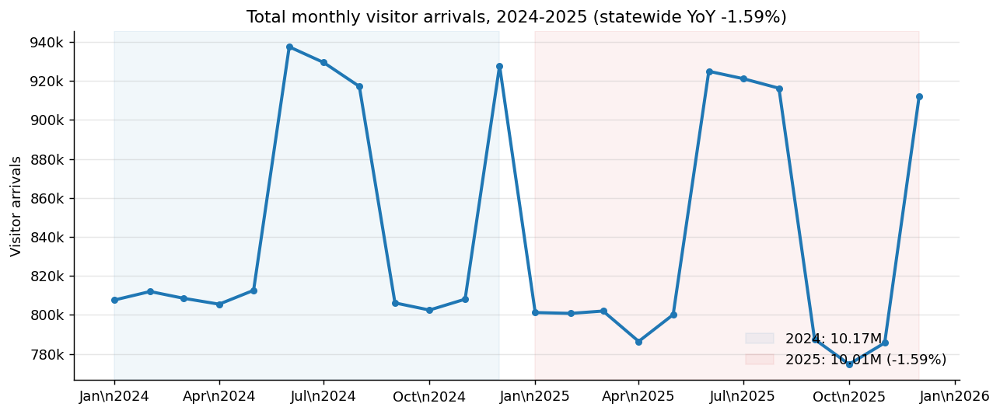
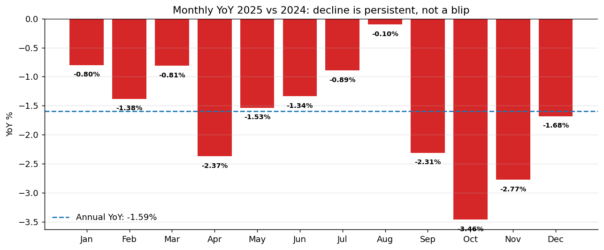
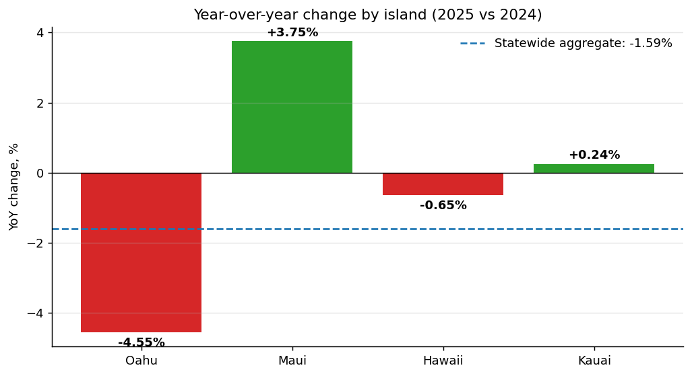
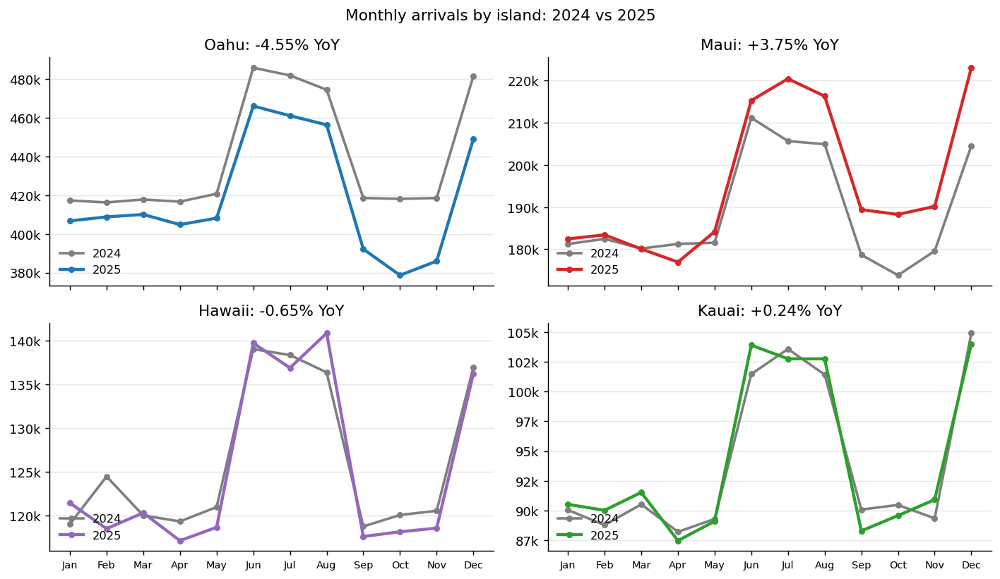
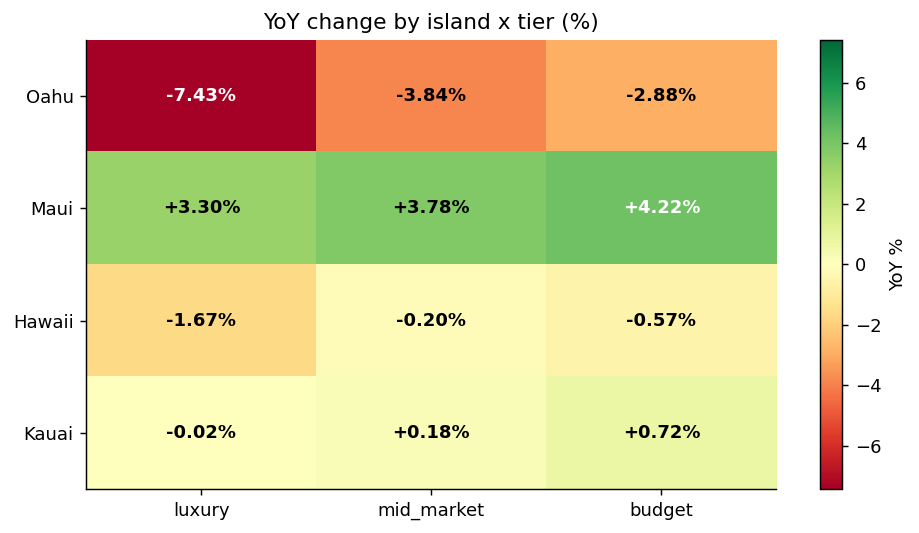
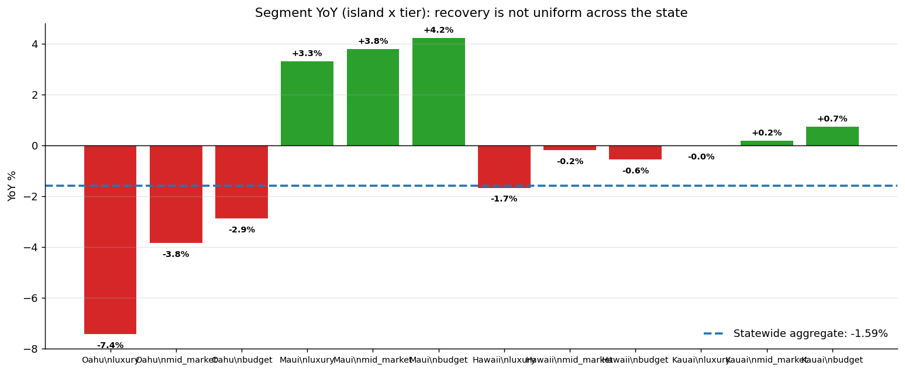
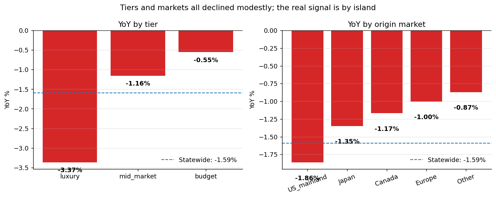
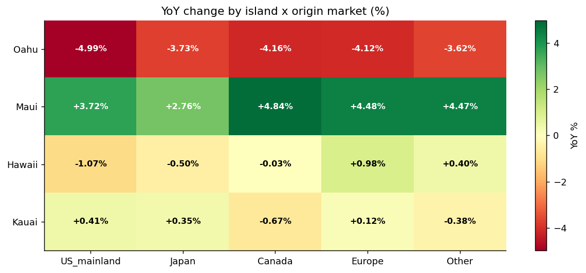
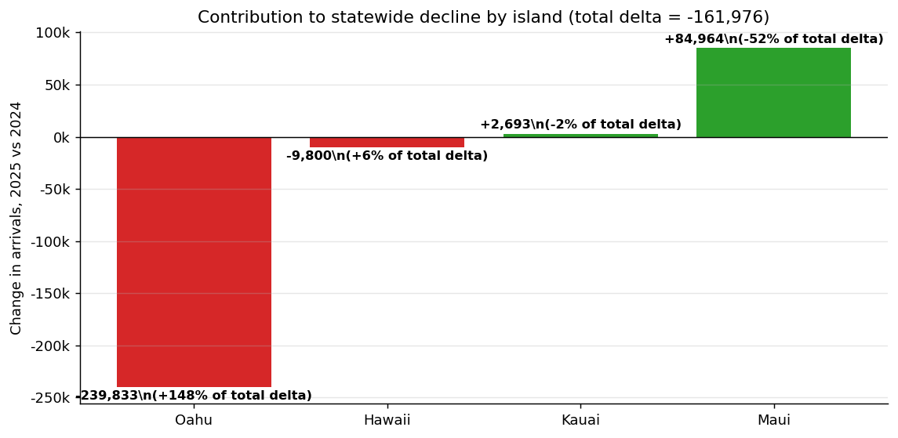

# Hawaii Visitor Arrivals 2024-2025: What the Statewide Numbers Are Hiding

**Prepared for:** Director, Hawaii Tourism Authority
**Period covered:** January 2024 - December 2025 (24 months of monthly arrivals by island, accommodation, tier, and origin market)
**Source:** tourism_monthly.csv (4,320 rows; 10.19M arrivals in 2024 vs 10.01M in 2025)

---

## The bottom line in one paragraph

Statewide arrivals fell **-1.59% in 2025 vs 2024** - about **162,000 fewer visitors**. That is small enough to sound like "recovery is done" from the 30,000-foot view, but it is the wrong read. Every single month of 2025 came in below its 2024 counterpart, and the statewide number is the net of two very different stories happening in parallel: **Maui grew +3.75% and gained 85,000 visitors, while Oahu fell -4.55% and lost nearly 240,000**. The regional offices complaining to you are almost certainly the Oahu team - and especially the Oahu luxury segment, which is down **-7.43% YoY**. The "recovery" is real in some places and broken in others; our aggregate is just hiding that.

---

## Finding 1: The aggregate decline is small, but it is persistent

2025 totals are *below* 2024 totals, not flat. That alone pushes back on the "recovery is done" framing - a completed recovery should look like growth, not a 1.6% contraction. More importantly, it is not noise:

- **All 12 months of 2025 were below their 2024 counterparts.** Not 8 out of 12, not 10 out of 12 - all 12.
- The decline is worst in the shoulder-season autumn months (**October -3.46%, September -2.31%, November -2.77%**), where we used to be hoping to stretch the season.
- Summer months held up best (August was nearly flat at -0.10%), suggesting the peak travel moments are still working but the surrounding periods are leaking demand.

**Why this matters to the director:** a persistent 1-3% monthly decline over 12 consecutive months is a trend, not a wobble. If it continues at this pace through 2026 without intervention, we would be looking at another ~160k-200k visitors gone.

---

## Finding 2: The statewide number is hiding a tale of two Hawaiis

This is the most important chart in the report. When the director says "arrivals are back to normal" he is reading the blue dashed line. The regional offices are living on the red bars.

| Island | 2024 arrivals | 2025 arrivals | YoY % | Share of statewide change |
|---|---:|---:|---:|---:|
| **Maui** | 2,265,139 | 2,350,103 | **+3.75%** | +52% (offset) |
| Kauai | 1,128,097 | 1,130,790 | +0.24% | about flat |
| Hawaii (Big Island) | 1,514,099 | 1,504,299 | -0.65% | small drag |
| **Oahu** | 5,267,346 | 5,027,513 | **-4.55%** | **-148% (dominant)** |
| Statewide | 10,174,681 | 10,012,705 | -1.59% | - |

Two ways of seeing this:

1. **Maui is booming**, picking up almost 85,000 additional visitors YoY on a base of 2.27M. Maui's offices should not be complaining, and probably are not.
2. **Oahu is bleeding**. It lost 240,000 visitors - more than the entire statewide decline, because Maui's gain was partially masking the damage. If Oahu had just held flat, the statewide number would be **+0.8%** and the director's talking point would be defensible.

You can see the gap between 2024 (gray) and 2025 (colored) visually: Maui's 2025 line sits entirely above 2024, Oahu's entirely below.

**Why this matters to the director:** saying "we are back" to Oahu-based operators is a credibility problem. Their businesses are seeing a real 4-5% pullback, which is large enough to hurt hiring, capital plans, and their trust in the Authority's read of the market.

---

## Finding 3: The Oahu problem is concentrated in luxury

Drilling into island x tier makes the story sharper:

Reading the grid:

- **Maui is up in every tier** (+3.3% to +4.2%). Consistent, broad-based growth - the regional office should be the one writing us congratulatory notes.
- **Kauai is essentially flat** across tiers (-0.02% to +0.72%).
- **Big Island (Hawaii) is down slightly** across all tiers but nothing dramatic (-0.20% to -1.67%).
- **Oahu is down in every tier**, and the luxury tier is by far the worst hit: **-7.43%**. Mid-market is -3.84%, budget -2.88%. Oahu luxury alone lost about 98,000 arrivals.

Ranking all 12 island x tier cells against the statewide aggregate makes the distortion obvious:

The statewide blue dashed line (-1.59%) sits in no-man's land: all three Oahu bars are well below it, all three Maui bars are well above it, and the two smaller islands cluster around it. The statewide average is essentially a lie that no individual island or tier is actually living.

**Why this matters:** Oahu luxury hotels make up a disproportionate share of tax revenue, jobs, and brand perception. A -7.4% drop in that segment should be on the front page of our internal dashboard, not buried in a -1.6% average.

---

## Finding 4: This is NOT primarily an origin-market story

If the decline were driven by Japan's weak yen or a US mainland softening, we would expect one origin market to crater while others hold up. That is not what we see.

Statewide YoY by origin market is remarkably uniform:

| Market | 2024 share | 2025 share | Share shift | YoY % |
|---|---:|---:|---:|---:|
| US mainland | 60.0% | 59.9% | -0.17 pp | -1.86% |
| Japan | 18.0% | 18.0% | +0.04 pp | -1.35% |
| Canada | 10.0% | 10.0% | +0.04 pp | -1.17% |
| Europe | 8.0% | 8.0% | +0.05 pp | -1.00% |
| Other | 4.0% | 4.0% | +0.03 pp | -0.87% |

Every market is down 0.9% to 1.9%, and the market mix is within 0.17 percentage points of unchanged. **This is not a demand-by-country story.** It is a place-level problem - specifically, it is an Oahu problem that all origin markets are experiencing:

Every origin market is:
- **up on Maui** (Japan +2.76%, US mainland +3.72%, Canada +4.84%, Europe +4.48%),
- **down on Oahu** (Japan -3.73%, US mainland -4.99%, Canada -4.16%, Europe -4.12%).

US mainland visitors to Oahu alone dropped **-157,000**, which by itself is about 97% of the entire statewide decline. But the same US mainland segment is up on Maui by 51,000. These travelers did not stop coming to Hawaii; they shifted where they go within Hawaii.

**Why this matters:** any response that targets origin markets (Japan marketing push, US mainland campaign) will miss. The problem is not that a market turned off. The problem is that when travelers pick a Hawaiian island, Oahu is losing that choice to Maui.

---

## Finding 5: Where the 162,000-visitor decline actually came from

Decomposing the statewide change of -162,000 visitors:

- **Oahu: -240,000** (about 148% of the total decline)
- Hawaii (Big Island): -10,000 (~6%)
- Kauai: +3,000 (slight offset)
- **Maui: +85,000** (offsetting 52% of the Oahu loss)

And by tier (statewide): luxury accounts for 53% of the decline on only 25% of the base - luxury is over-contributing to the pain because of Oahu luxury specifically.

---

## Recommended positioning for the director

Three things to stop saying, three things to start saying, three things to actually do.

### Stop saying

1. **"Visitor arrivals are back to normal."** Statewide arrivals are *contracting* at -1.6% YoY across 12 consecutive months. The phrase is not defensible in a budget hearing once anyone pulls out the monthly series.
2. **"The numbers look fine."** They look fine *in aggregate*. In the places where our stakeholders actually operate - Oahu luxury hotels, Oahu tour operators - they do not look fine at all.
3. **"We have a demand problem with [Japan / US mainland / etc.]."** Every origin market declined at essentially the same small statewide rate, and every origin market is *up* on Maui. We do not have a country-level demand problem; we have an Oahu-share problem.

### Start saying

1. **"Statewide arrivals are down ~1.6%, but that hides a huge split. Maui is up ~4%, Oahu is down ~4.5%. That is the real story."**
2. **"Our Oahu luxury segment is down ~7.4% YoY. That is a priority-one issue."**
3. **"Visitors are still coming to Hawaii at roughly the same rate - they are just choosing Maui over Oahu more often. We need to figure out why."**

### Do

1. **Commission a fast Oahu vs Maui choice study.** Survey recent Hawaii visitors who picked Maui about why they did not pick Oahu. Hypothesis candidates to test: (a) Oahu hotel rates outran Maui post-wildfire rebuild, (b) Waikiki perception (crowding, safety, construction) has degraded vs Maui resort experience, (c) Lahaina reopening narrative created a "help Maui recover" pull. We cannot fix this until we know which of these is dominant.
2. **Review the 2026 marketing mix for Oahu.** If we are still allocating spend proportional to past arrivals, Oahu is getting too little given its 4.5% contraction. Consider a targeted Oahu-only campaign, especially into Q3/Q4 which are our worst shoulder months.
3. **Meet with the Oahu regional office this week** to acknowledge the data supports their complaint. Trust with regional partners is a renewable resource only if we behave like we can see what they see. Showing the director agrees with their reading will buy more cooperation than any new program.

---

## Caveats on the data

- This is 24 months of monthly arrivals only. It does not include length of stay, spend per visitor, hotel occupancy, or ADR - so "arrivals" is an incomplete read of *economic* recovery. If Oahu is losing volume but making it up on rate, the full revenue picture may be less grim (or worse if rate also softened).
- We do not have pre-2024 data in this file, so we cannot benchmark "recovery" against a pre-COVID 2019 or a 2022 baseline. All claims about "recovery is done" vs "still recovering" should cite whatever baseline the director is comparing to - if it is a 2019 arrivals target, we need to know whether 2024 and 2025 are actually at or below that target.
- The data appears clean (no nulls, no negative values, full balanced panel of island x tier x market x accommodation x month), so the findings above should be robust within the scope of the data provided.

---

## Appendix: chart index

- 01_total_monthly.png - statewide monthly arrivals, 2024-2025
- 02_yoy_by_island.png - YoY % by island vs statewide aggregate
- 03_island_monthly.png - monthly arrivals by island, stacked lines
- 04_yoy_tier_market.png - YoY by tier and origin market, with statewide reference line
- 05_heatmap_island_tier.png - island x tier YoY heatmap
- 06_heatmap_island_market.png - island x origin market YoY heatmap
- 07_island_2024_vs_2025.png - monthly 2024 vs 2025 for each island
- 08_contribution_by_island.png - absolute arrival change by island
- 09_segments_vs_aggregate.png - every island x tier cell vs statewide aggregate
- 10_monthly_yoy.png - monthly YoY %, all 12 months

