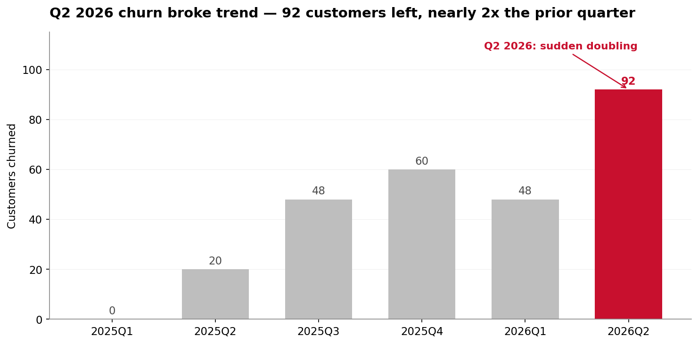
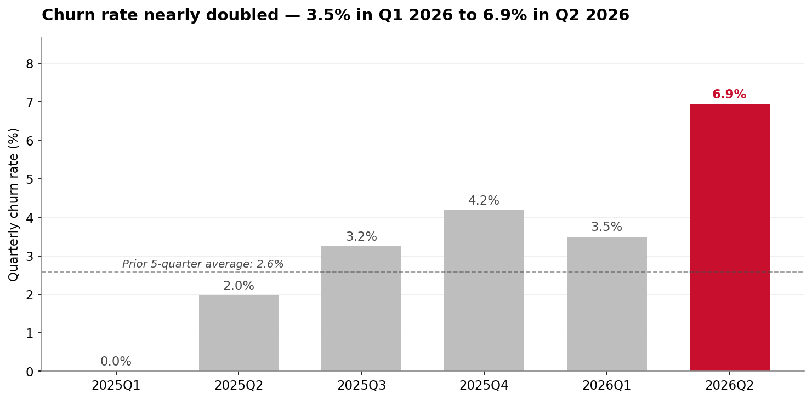
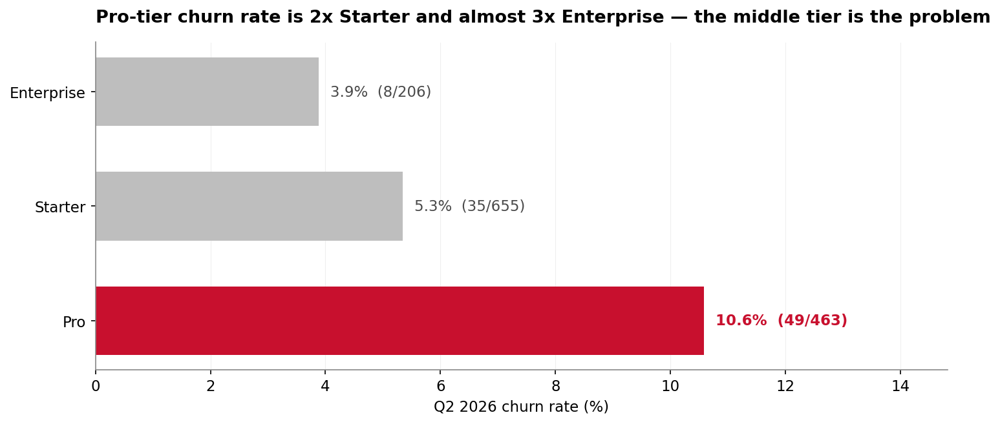
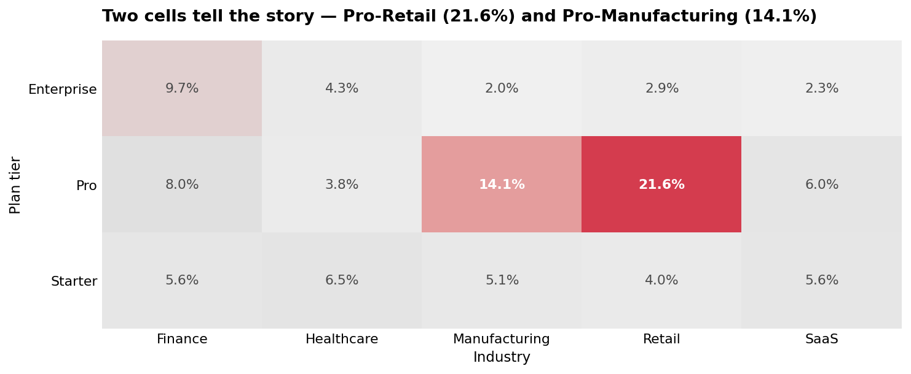
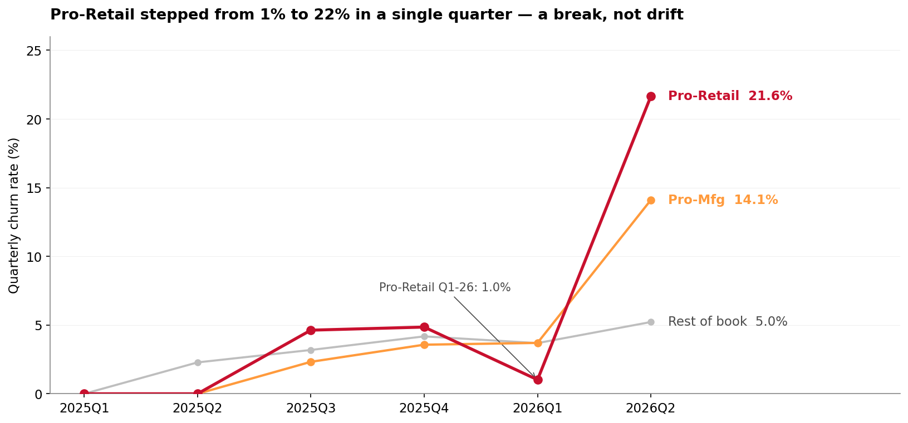
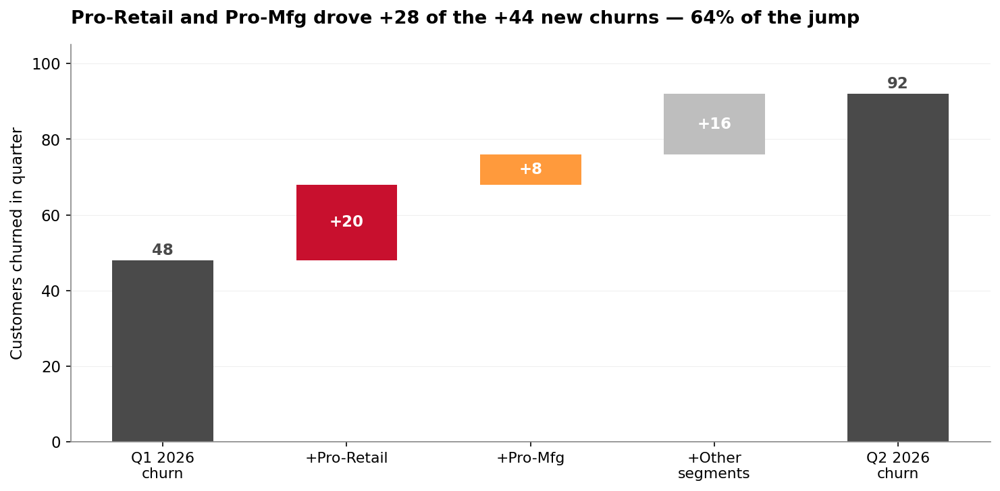
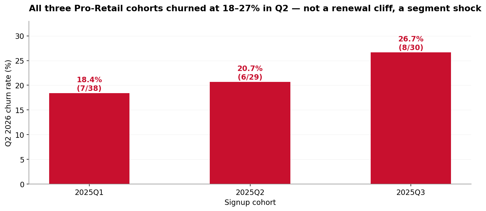
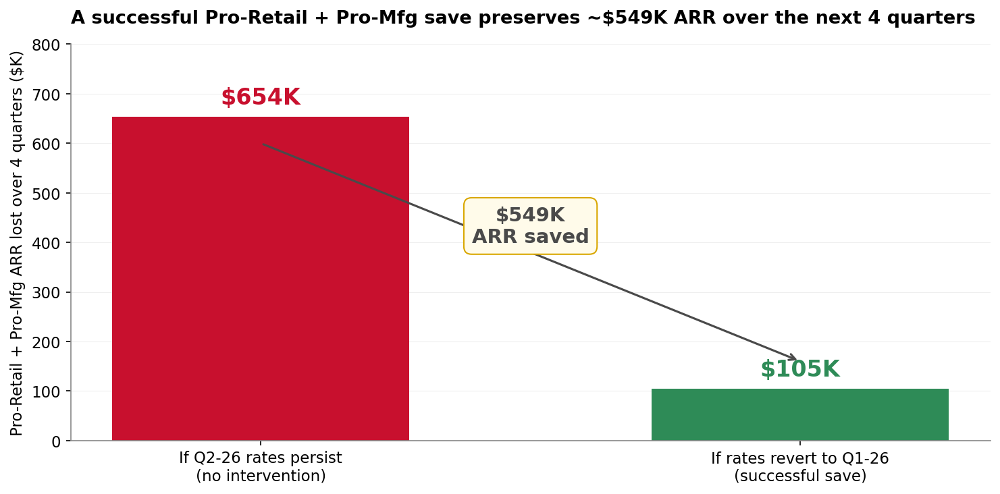

<!-- _class: lead -->

# Q2-2026 churn doubled — here's what drove it and what we do next

### Prepared for the Board of Directors • April 2026

Analysis covers 1,500 customers, 268 churn events across 2025Q1–2026Q2.

---

## Headline, evidence, ask — in one minute

### Headline
**The Q2-2026 churn spike is not broad.** Two segments — Pro-Retail and Pro-Manufacturing — drove 64% of the new churns. Everything else drifted by <2 points.

### Evidence
- Quarterly churn rate: 3.5% → 6.9% QoQ (nearly doubled)
- Pro-Retail churn rate: **1.0% → 21.6%** in a single quarter
- Pro-Mfg churn rate: **3.7% → 14.1%** QoQ

### Ask
Sanction a **90-day Pro-Retail save program** and a **2-week root-cause sprint** — estimated to preserve **~$549K ARR** over the next 4 quarters.

---

## Q2-2026 churn broke trend — 92 customers left, nearly 2x the prior quarter

- Through Q1-26, churn drifted between 48–60 customers per quarter
- Q2-26: **92 customers, $838K ARR**
- This is a break, not a gradual deterioration

<!-- Speaker note: Anchor the board in absolute numbers before moving to rates. -->

---

## Churn rate nearly doubled — 3.5% to 6.9% quarter over quarter

- Exposure-adjusted: we account for the growing customer base
- Prior 5-quarter average was **3.4%**; Q2-26 is **2x that baseline**
- This rules out "more customers, more churn" — the rate itself spiked

<!-- Speaker note: Rate is the right metric because our customer base grew. -->

---

## The spike isn't the low end — Pro-tier churned 2x Starter and almost 3x Enterprise

- **Pro tier**: 10.6% (49 of 463) — the outlier
- **Starter**: 5.3% (35 of 655)
- **Enterprise**: 3.9% (8 of 206)

Intuition said "cheap plans = first to leave." Data says the opposite.

<!-- Speaker note: This is the slide where the board's first hypothesis gets overturned. -->

---

## Two cells tell the story — Pro-Retail (21.6%) and Pro-Manufacturing (14.1%)

- Out of **15** plan-tier × industry cells, only **two** are in crisis
- Pro-Retail is **5× the next-worst industry in the Pro tier**
- Starter and Enterprise rates are stable across every industry

<!-- Speaker note: The heatmap makes the concentration visually undeniable. -->

---

## Pro-Retail stepped from 1% to 22% in a single quarter — a break, not drift

- Pro-Retail Q1-26 rate was **1.0%** (1 of 98 customers)
- Pro-Retail Q2-26 rate is **21.6%** (21 of 97)
- That is a **21× step** — consistent with a discrete trigger inside the quarter

<!-- Speaker note: Something happened in Q2 itself; this isn't a slow leak. -->

---

## Pro-Retail and Pro-Mfg drove +28 of the +44 new churns — 64% of the jump

- Total churns rose by 44 QoQ
- **+20** came from Pro-Retail alone
- **+8** from Pro-Manufacturing
- Rest of book contributed **+16** combined — a drift, not a crisis

Two segments = **64% of the count jump, 50% of the ARR jump**.

---

## It's not a renewal cliff — all three signup cohorts churned at similar rates

- 2025Q1 signups (now ~15 months in): **18.4%**
- 2025Q2 signups (~12 months): **20.7%**
- 2025Q3 signups (~9 months): **26.7%**

A renewal-cycle effect would cluster in one cohort. This is a **segment shock** hitting every cohort at once.

---

## The data tells us *where* — we need 2 weeks to find *why*

**What we know** (from the data):
The spike is segment-specific (Pro-Retail, Pro-Mfg) and time-specific (Q2-26). It is not cohort-driven, not tier-driven at the low end, and not a measurement artifact.

**What we don't know** (not in the data):
The *trigger*. Possibilities: a Q2 product release that hurt Retail workflows, a competitor move, a pricing change, an account-exec turnover event, an industry-wide macro shock. The data cannot distinguish these.

**Recommendation**: a 2-week discovery sprint — 25 customer interviews plus a cross-check against product/pricing/GTM timelines — will name the mechanism.

---

## A successful save preserves ~$549K ARR over the next 4 quarters

- **If rates persist** (no intervention): Pro-Retail + Pro-Mfg alone lose **$654K ARR**
- **If rates revert** to Q1-26 baseline: loss is **$105K ARR**
- **Bending the curve is worth ~$549K** over 4 quarters

Assumption: geometric decay at respective Q2-26 rates; sensitivity range $105K–$654K.

---

## Three actions we recommend the board sanction today

| # | Action | Owner | Success metric | Confidence |
|---|--------|-------|----------------|------------|
| **1** | 90-day **Pro-Retail save program** — dedicated CSM, exec sponsor calls to all 76 active Pro-Retail accounts | VP CS (lead), CRO (sponsor) | Pro-Retail Q3-26 rate **≤ 8%** | **High** |
| **2** | 2-week **root-cause sprint** — 25 customer interviews + product/pricing/GTM timeline cross-check | Head of Product + Head of Sales (joint) | Written memo naming the Q2 trigger by **May 2** | **High** |
| **3** | Put **Pro-Manufacturing on watch** — weekly health-score review, save play if Q3-26 rate > 10% | VP Customer Success | Pro-Mfg Q3-26 rate **≤ 7%** | **Medium** |

---

## Action 1 — Pro-Retail save program (90 days)

### What
- Assign a **named CSM** to each of the 76 active Pro-Retail accounts
- **CRO-sponsored outreach** to the 10 largest Pro-Retail accounts within week 1
- **Structured save conversation** template: discovery of trigger → retention offer → escalation path
- **Weekly pipeline review** with CRO and VP CS

### Why it's high confidence
The evidence points to a single identifiable segment (76 customers, $638K ARR). The population is small enough for 1:1 intervention. The 21× step change signals the trigger is recent and recoverable if addressed in the current quarter.

### Investment
~1 dedicated CSM + partial exec bandwidth for one quarter. **Downside capped; upside ~$400K ARR.**

---

## Actions 2 & 3 — Name the trigger, contain the spread

### Action 2: 2-week root-cause sprint
- 15 exit interviews with Q2-26 Pro-Retail churners (offer incentives)
- 10 interviews with at-risk active Pro-Retail accounts
- Timeline audit: Q2 product releases, price changes, comp plan changes, Retail-sector macro signals
- **Deliverable: a 2-page memo by May 2** naming the trigger with evidence

### Action 3: Pro-Manufacturing early-warning
- Weekly churn-rate and health-score review on all 67 active Pro-Mfg accounts
- Clear escalation threshold: if Q3-26 rate crosses **10%**, activate the same save program
- Avoids waiting until it's also a crisis

---

## The ask: approve today; first results at Q3-26 board meeting

### Decision requested
1. **Approve** the 90-day Pro-Retail save program (R1)
2. **Approve** the 2-week root-cause sprint (R2)
3. **Note** the Pro-Manufacturing watch (R3)

### Timeline
- **By May 2**: root-cause memo delivered
- **End of Q3-26**: board update with retention metrics by segment

### If we do nothing
Baseline projection loses **$654K ARR** from these two segments alone over the next 4 quarters — equivalent to **4.1% of our current ARR book ($15.96M)**.

Caveat: analysis covers customers signed up 2025Q1–Q3 (≤18 months tenure). Older customers, if present, are not observable in this dataset. Full methodology in appendix (`validation.md`).
