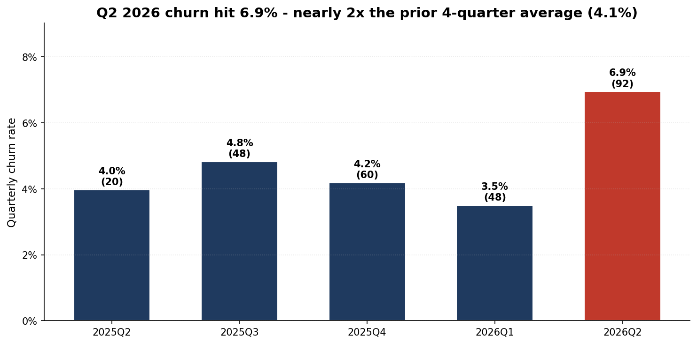
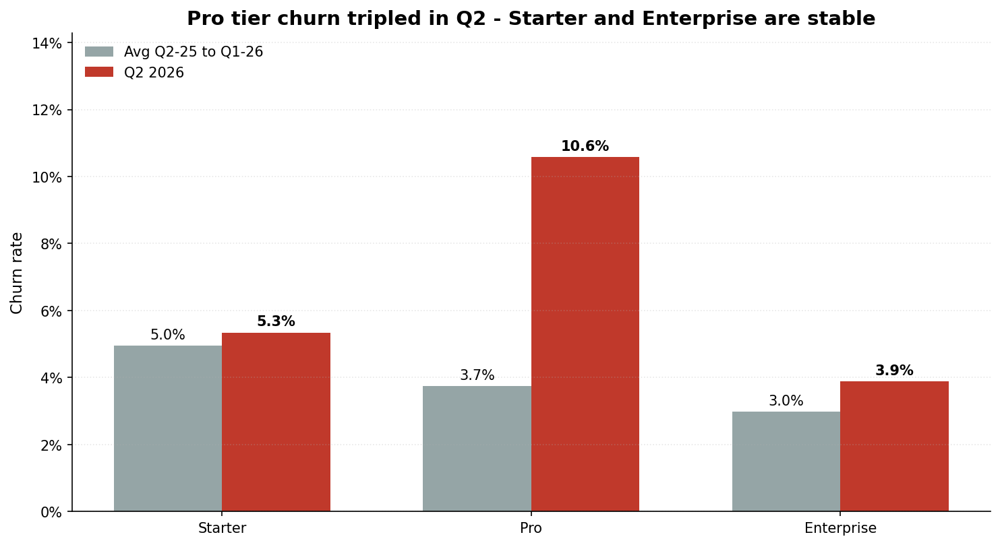
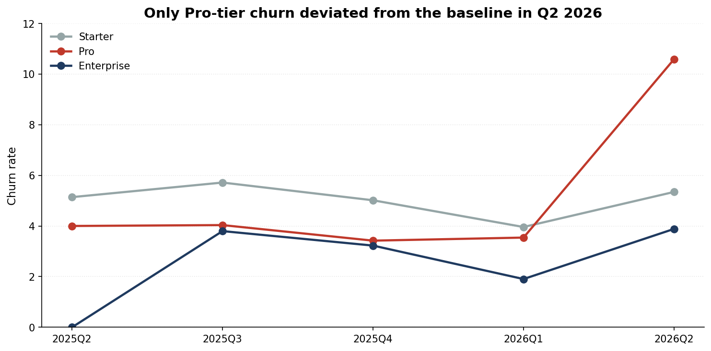
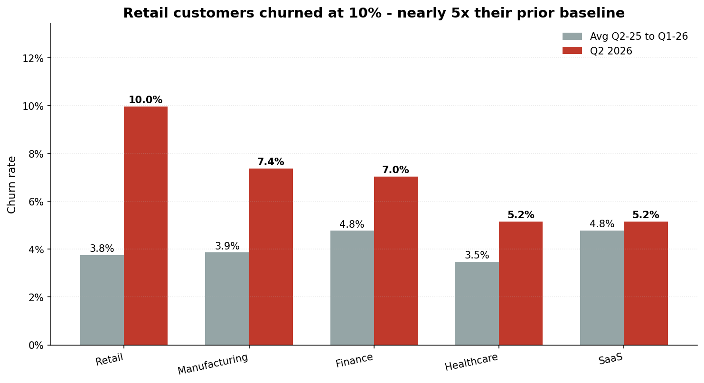
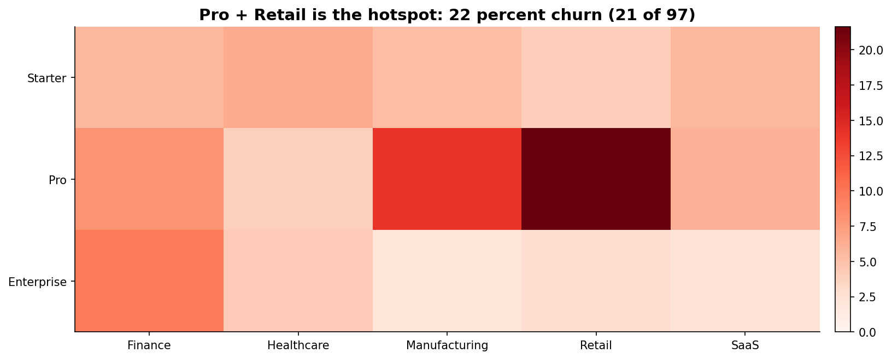
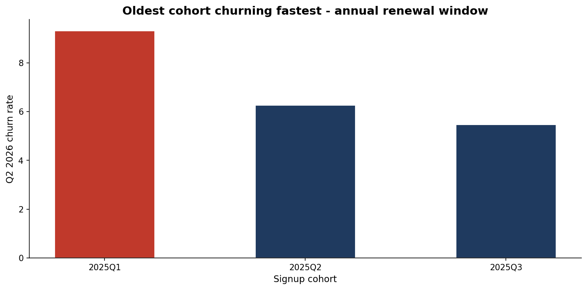
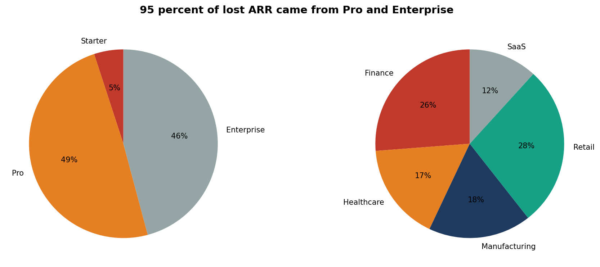

# Q2 2026 Churn Spiked to 6.9% - Pro-Tier Retail Is the Epicenter

**$838K ARR lost this quarter - double our run-rate**

Board briefing  |  Customer Success and Revenue Ops  |  April 2026

---

# Churn Nearly Doubled in a Single Quarter

- Q2 2026 churn: **6.9%** vs 4.1% average over the prior four quarters
- 92 customers churned vs 48 in Q1 - a **92% jump** quarter-over-quarter
- Leaves an estimated **$838K** of ARR gap to close against plan

---

# The Pro Tier Is the Single Biggest Driver

- Pro-tier churn **tripled** from a 3.7% baseline to **10.6%**
- Starter tier and Enterprise tier held within their normal range
- 49 of 92 (53%) of all Q2 churners came from the Pro tier

---

# Pro Is the Only Tier That Broke From Trend

- Starter (~5%) and Enterprise (~3%) held steady through Q2
- Pro broke out of its 3-4% band for the first time in 5 quarters
- This is a segment-specific issue, **not** a company-wide trend

---

# Retail Customers Led the Surge

- Retail churn jumped from 2.1% in Q1 to **10.0%** in Q2 - nearly 5x
- Finance (7.0%) and Manufacturing (7.4%) also elevated
- Healthcare and SaaS remained near their normal baselines

---

# The Hotspot: Pro + Retail = 22% Churn

- **21 of 97** Pro-tier Retail customers left us in a single quarter
- Pro-tier Manufacturing (14%) is the next-most distressed segment
- Every other Plan x Industry cell stayed below 10%

---

# Older Cohorts Are Hitting the Renewal Cliff

- Customers signed in **2025 Q1** (now at 12-18 month tenure) churned at 9.3%
- Churn rate declines the newer the cohort - this looks like **annual-renewal fatigue**
- Reinforces that the spike is concentrated in a specific vintage, not broad dissatisfaction

---

# 95% of Lost ARR Came From Pro and Enterprise

- Pro: **$412K (49%)** | Enterprise: **$384K (46%)** | Starter: $42K (5%)
- Retail alone accounts for **$232K (28%)** of lost ARR
- High-value Enterprise churn is small in count (8) but large in dollars

---

# What We Think Is Driving It

1. **Pro-tier value gap** - Pro customers pay mid-market prices but likely do not feel differentiated value vs. Starter; competitors are winning on price
2. **Retail vertical headwind** - Retail macro pressure and budget cuts in Q2; this is the segment most sensitive to that
3. **Renewal timing** - The 2025 Q1 Pro cohort just passed its 12-month mark; cancellations cluster at renewal

*Bottom line: this is a concentrated segment problem, not a broad-based churn crisis*

---

# What We Are Doing Now (Next 30 Days)

| Action | Owner | Outcome |
|---|---|---|
| Call every at-risk Pro+Retail customer (97 accounts) | CS Leadership | Identify save candidates; capture reasons |
| Launch targeted Pro-tier value check-in program | CS Ops | Re-justify ROI before renewal |
| Stand up Pro-to-Enterprise upgrade promotion | Sales + Product | Move best-fit customers to stickier plan |

---

# Medium-Term Plan (Q3 2026)

| Action | Owner | Outcome |
|---|---|---|
| Rework Pro-tier packaging and pricing with new features | Product + Pricing | Close the value gap |
| Retail-specific playbook and verticalized success content | CS Marketing | Reduce Retail sensitivity |
| Early-warning model flagging at-risk Pro accounts 90 days pre-renewal | Data + CS | Proactively save before renewal |

---

# Financial Impact If We Hold the Line

- If Q2 churn rate held through year end: **~$3.3M ARR** at risk
- If we cut Pro-tier churn back to its 3.7% baseline: **~$285K/qtr recovery**
- **Retention goal:** Return company-level churn to 4% baseline by Q4 2026

*One successful segment fix delivers ~34% of that target*

---

# The Ask

1. **Approve $400K retention budget** for Q3 2026
   - Pro-tier value uplift (product work + packaging)
   - Retail vertical CS program
2. **Endorse Pro-tier repricing** - willing to trade some gross margin for lower churn
3. **Agree to a monthly churn review** at the exec level until rate returns to baseline

**Decision needed this meeting so we can execute before the next Pro renewal wave in July**

---

# Backup | Methodology and Quarterly Numbers

Data: 1,500 customers, signup quarters 2025 Q1-Q3, observed through 2026 Q2. Quarterly churn rate = churned in Q / active at start of Q. Baseline = prior 4Q average.

| Quarter | Active @ Start | Churned | Rate | ARR Lost |
|---|---|---|---|---|
| 2025 Q2 | 503 | 20 | 4.0% | $74K |
| 2025 Q3 | 995 | 48 | 4.8% | $439K |
| 2025 Q4 | 1,432 | 60 | 4.2% | $522K |
| 2026 Q1 | 1,372 | 48 | 3.5% | $367K |
| **2026 Q2** | **1,324** | **92** | **6.9%** | **$838K** |
