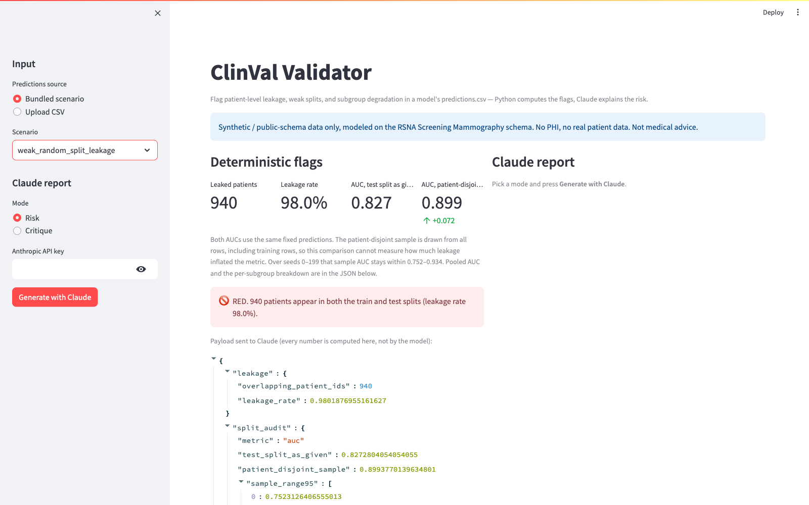

# clinval-validator

ClinVal Validator reads a model's `predictions.csv` and reports two failure modes that make a clinical-AI performance claim unsafe: the same patient in both the train and test splits, and a subgroup whose AUC is lower than the rest of the table. Python computes the metrics, the flags, and the risk level. Claude is instructed to turn that JSON into prose and to cite only numbers present in it. Nothing in this repository checks the text Claude returns.



*Offline view of the bundled synthetic `weak_random_split_leakage` scenario. No API key was entered and no Claude report was requested. The fourth metric is the AUC of a patient sample drawn from all rows, including training rows. The +0.072 figure is that sample minus the test-split AUC. The RED line is the risk level computed by Python.*

The column names follow the Radiological Society of North America (RSNA) Screening Mammography Breast Cancer Detection dataset. This repository contains synthetic tables and that public schema only. It contains no RSNA images and no protected health information (PHI). It is not medical advice.

## Risk level

`risk.level` is one of `RED`, `YELLOW`, or `GREEN`.

- `RED` when `overlapping_patient_ids` is greater than zero: at least one `patient_id` is in both `split == "train"` and `split == "test"`.
- `YELLOW` when there is no such overlap and at least one subgroup is flagged.
- `GREEN` when neither of those is true.

`risk.reasons` states the numbers that produced the level. The split audit is not an input to this rule.

## Subgroup flag

The check evaluates `machine_id` and `site_id`. When a `density` column is present it evaluates each density value. When an `age` column is present it evaluates decade bands such as `50-59`. Missing density or age values are left out of that grouping.

A subgroup is evaluated when it has at least 50 rows and both the subgroup and the rest of the table contain class 0 and class 1. `delta_vs_rest` is the subgroup AUC minus the AUC of every other row. `delta_ci95` is the 2.5th and 97.5th percentile of that difference over a patient-level bootstrap: resample `patient_id` with replacement, 200 replicates, seed 0. Replicates that lack a class are skipped.

A subgroup is flagged when `delta_vs_rest` is at or below −0.10 and the upper end of `delta_ci95` is below zero.

On 30 tables from the bundled generator (seeds 7–36; 2,000 patients and about 1.5% positive images per table), 6 of 30 clean patient-grouped tables received a flag, the injected M030 drop was missed in 4 of 30 scanner tables, and the injected density C/D drop was flagged in 21 of 30 tables. These rates come from that generator, not from real data. At this sample size a flag is a candidate drop to confirm on more data, and the absence of a flag does not show that every subgroup performs like the rest.

`mean_predicted` (mean `y_prob`) and `observed_rate` (mean `y_true`) are calibration-in-the-large for that subgroup. They are reported and they do not flag. On `optimistic_site_shortcut`, mean `y_prob` by site runs from 0.331 to 0.754 while the observed positive rate runs from 0.97% to 2.3%.

## Split audit

`test_split_as_given` is the AUC on rows with `split == "test"`. `patient_disjoint_sample` is the AUC on a seed-0 sample of 15% of patients drawn from every row, so the sample includes training rows. `sample_range95` is the 2.5th and 97.5th percentile of that sample AUC over seeds 0–199. `gap` is `test_split_as_given` minus `patient_disjoint_sample`.

Both AUCs use the predictions already in the file. The audit does not measure how much leakage changed a metric, and it does not set the risk level.

## Input

A predictions table needs these columns:

```
patient_id, machine_id, site_id, y_true, y_prob, split
```

`split` may be `train`, `val`, or `test`. The leakage check compares `train` and `test` only. Rows with `split == "val"` are ignored by that check. `y_true` is 0 or 1. `y_prob` is a number in the closed interval from 0 to 1. The test rows must contain both classes.

`density` and `age` are optional. The fixtures also carry `image_id`, `laterality`, and `view`. The checks ignore columns they do not name.

The pooled AUC and the subgroup AUCs treat every row's `y_prob` as a held-out or out-of-fold prediction. A score that was produced on a row the model saw in training is not that quantity, and the file does not record which rows were held out beyond the `split` column.

Labeled fixtures live in [`claude-science-artifacts/scenarios/`](claude-science-artifacts/scenarios/).

An uploaded file that fails these checks is rejected before any metric runs. The command-line tool prints the problems on stderr and exits 2. The browser UI shows the same problems and stops.

## Quickstart

```bash
# Python 3.11+. Installs the package and pytest.
python -m pip install -e '.[dev]'

# ANTHROPIC_API_KEY unset: the JSON payload is printed and the process exits 1.
clinval-validate --predictions claude-science-artifacts/scenarios/weak_random_split_leakage.csv
echo "exit code: $?"

python -m pytest -q
```

With `ANTHROPIC_API_KEY` set, the same command prints the risk report instead of the payload and exits 0. `--mode critique` asks for a reviewer critique and a Methods paragraph. The key is read from the environment. It is not stored in the repository.

```bash
python -m pip install -e '.[demo]'
streamlit run app.py
```

## Browser UI

`streamlit run app.py` runs the same checks.

- Choose a bundled scenario or upload a `predictions.csv`.
- The checks run without an API key. The page shows the leakage count, the split audit, and the JSON payload, including `risk.level`.
- The key typed into the sidebar is sent only with that session's request. It is not written into the process environment.
- **Generate with Claude** asks for the risk report or the reviewer critique. Both are optional.
- Download the payload as JSON and, after a report is generated, the report as Markdown.

## Sample payload

`run_checks` on `weak_random_split_leakage` produces the payload below. The `subgroups` list is truncated: the command prints all 20 evaluated subgroups, and only the first is shown here.

```json
{
  "leakage": {
    "overlapping_patient_ids": 940,
    "leakage_rate": 0.9801876955161627
  },
  "split_audit": {
    "metric": "auc",
    "test_split_as_given": 0.8272804054054055,
    "patient_disjoint_sample": 0.8993770139634801,
    "sample_range95": [0.7523126406555013, 0.933559031020775],
    "gap": -0.07209660855807465
  },
  "subgroups": [
    {
      "key": "machine_id",
      "value": "M031",
      "n": 1020,
      "auc": 0.8075241391874658,
      "auc_rest": 0.8490112630891348,
      "delta_vs_rest": -0.041487123901668976,
      "delta_ci95": [-0.17020941694803463, 0.052104879910572145],
      "mean_predicted": 0.511070955882353,
      "observed_rate": 0.021568627450980392,
      "flagged": false
    }
  ],
  "pooled_metric": {"name": "auc", "value": 0.8424535490580416},
  "risk": {
    "level": "RED",
    "reasons": [
      "940 patients appear in both the train and test splits (leakage rate 98.0%)."
    ]
  }
}
```

The report below is hand-written so that a reader can see the shape. It is not output from Claude.

```
1. Overall risk — RED. 940 patients appear in both the train and test splits (leakage rate 98.0%).

2. What the data shows — The leakage rate is 0.9802, which is 940 divided by the number of distinct test patients. Pooled AUC is 0.8425. The test-split AUC is 0.8273 and the patient-disjoint sample AUC is 0.8994 (gap −0.0721). The sample range over seeds 0–199 is 0.7523 to 0.9336. No subgroup is flagged. The first subgroup, machine M031, has AUC 0.8075 against 0.8490 on the rest of the table.

3. What can be claimed — The file records 940 patients on both sides of the split.

4. What cannot be claimed — An AUC from this file does not estimate performance on patients who were absent from training.

5. Next validation step — Retrain and evaluate with a patient-grouped split, so that no test patient was seen in training.
```

The demo script is [docs/DEMO.md](docs/DEMO.md).

## RSNA adapter

[`rsna_to_predictions.py`](rsna_to_predictions.py) is a local-only adapter. It reads a `train.csv` from the RSNA Screening Mammography Breast Cancer Detection dataset and writes a predictions table. The RSNA license bans redistribution, so `data/rsna/` and `predictions_rsna*.csv` are gitignored and are not part of this repository.

```bash
python rsna_to_predictions.py --input data/rsna/train.csv
```

The default run writes `predictions_rsna_random.csv` and `predictions_rsna_patient_grouped.csv`. The scores in those files come from a tabular baseline on pre-imaging metadata, not from an imaging model.

## License

MIT. See [LICENSE](LICENSE).

July 2026 planning notes are in [docs/archive/](docs/archive/).
