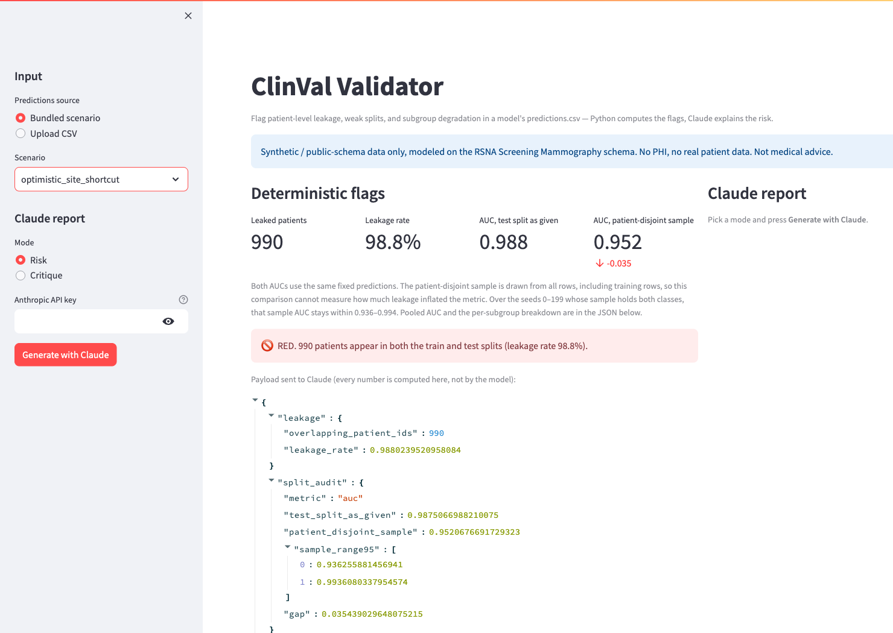

# ClinVal Validator

[](https://github.com/vbabenko97/clinval-validator/actions/workflows/tests.yml)

ClinVal Validator reads a model's `predictions.csv` and reports two failure modes that make a clinical-AI performance claim unsafe: the same patient in both the train and test splits, and a subgroup whose AUC is lower than the rest of the table. Python computes the metrics, the flags, and the risk level. Claude is instructed to turn that JSON into a validation risk report and to cite only numbers present in it. Nothing in this repository checks the text Claude returns.



*Offline view of the bundled synthetic `optimistic_site_shortcut` scenario. No API key was entered and no Claude report was requested. A test-split AUC of 0.988 would look publishable, but 990 patients are in both the train and test splits, so Python sets the risk level to RED. The fourth metric is the AUC of a patient sample drawn from all rows, including training rows. The −0.035 figure is that sample minus the test-split AUC; it does not measure inflation.*

The column names follow the Radiological Society of North America (RSNA) Screening Mammography Breast Cancer Detection dataset. This repository contains synthetic tables and that public schema only. It contains no RSNA images and no protected health information (PHI). It is not medical advice.

## Quickstart

```bash
# Python 3.11+. Installs the package and pytest.
python -m pip install -e '.[dev]'

# ANTHROPIC_API_KEY unset: the JSON payload is printed and the process exits 1.
clinval-validate --predictions claude-science-artifacts/scenarios/optimistic_site_shortcut.csv
echo "exit code: $?"

python -m pytest -q
```

With `ANTHROPIC_API_KEY` set, the same command prints the risk report instead of the payload and exits 0. The reporter calls Claude Opus 5.5 (`claude-opus-5-5`) at low effort; if a safety classifier declines a request, the API reruns it on the model Anthropic recommends for that refusal category. `--mode critique` asks for a reviewer critique and a Methods paragraph. The key is read from the environment. It is not stored in the repository. If the API request fails (for example no credits, an invalid key, or no connection), or Claude's reply is cut off at the 4,096-token limit, refused, or contains no text, the command prints the payload, states the reason on stderr, and exits 1; the browser UI shows the same message.

```bash
python -m pip install -e '.[demo]'
streamlit run app.py
```

Each bundled scenario in [`claude-science-artifacts/scenarios/`](claude-science-artifacts/scenarios/) records its injected flaws, none for the clean control, in a `*.manifest.json` next to the CSV.

| Scenario | Injected flaw | Risk level | What the checks report |
|---|---|---|---|
| `clean_patient_grouped` | none | GREEN | no patient overlap, no flagged subgroup |
| `weak_random_split_leakage` | rows assigned to splits at random | RED | 940 patients in both train and test |
| `duplicate_row_leakage` | near-duplicate rows copied from train to test | RED | 113 patients in both train and test |
| `optimistic_site_shortcut` | high AUC, a site-correlated score offset, random split | RED | 990 patients in both train and test |
| `subgroup_scanner_degradation` | low AUC on scanner `M030` | YELLOW | `machine_id` M030 and `site_id` S03 flagged |
| `subgroup_density_degradation` | low AUC on density C and D | YELLOW | density C flagged |

## Example report

This report was rendered from the `optimistic_site_shortcut` payload in October 2026 with the reporter's model (`claude-opus-5-5`, low effort) and system prompt. It is one of three runs of that configuration in the model comparison recorded in [CLAUDE.md](CLAUDE.md). Claude's wording varies between runs. Each metric value in it is in that scenario's payload.

> **1. Overall risk:** RED
>
> 990 patients appear in both the train and test splits, a leakage rate of 98.8%. Nearly every test patient was also seen in training, so test-split metrics do not measure performance on new patients.
>
> **2. What the data shows**
>
> - The test-split AUC is 0.9875. Because of the 98.8% patient overlap, it is not an unseen-patient estimate.
> - split_audit rescored the same fixed predictions on a seed-0 patient sample drawn from all rows, including training rows. That sample gave AUC 0.9521, with a 95% range of 0.9363–0.9936 across seeds and a gap of 0.0354. This rescore says nothing about inflation in either direction.
> - The pooled AUC over all rows is 0.9647. It is valid only if every y_prob is a held-out or out-of-fold prediction.
> - Of 20 subgroups evaluated, 0 were flagged. 0 delta intervals lie entirely below zero and 9 lie entirely above zero, for example site S03 (+0.031, CI 0.018–0.048).
> - Calibration-in-the-large is badly off in every subgroup. Machine M010 has mean predicted 0.753 against an observed rate of 0.033. Machine M001 has 0.462 against 0.0075. Predicted probabilities are many times the observed prevalence.
>
> **3. What can be claimed**
>
> - The model's scores rank positives above negatives within this dataset, which includes patients it trained on.
> - No subgroup crossed the flagging threshold.
> - The probabilities as output are severely miscalibrated.
>
> **4. What cannot be claimed**
>
> - **Any AUC as unseen-patient performance.** This covers the test-split figure (0.9875), the pooled figure (0.9647) and the patient-sample figure (0.9521). Metrics measured while the same patients sit in train and test do not estimate generalization.
> - **Subgroup equity or the absence of subgroup weakness.** The subgroup comparisons inherit the same leakage.
> - **Clinically usable probabilities or thresholds.** Calibration fails in every subgroup.
>
> **5. Next validation step**
>
> Retrain and evaluate with a patient-grouped split so that no test patient appears in training. Then recompute AUC, subgroup deltas and calibration on that held-out set. Re-scoring the existing predictions cannot fix the leakage.

## Risk level

`risk.level` is one of `RED`, `YELLOW`, or `GREEN`.

- `RED` when `overlapping_patient_ids` is greater than zero: at least one `patient_id` is in both `split == "train"` and `split == "test"`.
- `YELLOW` when there is no such overlap and at least one subgroup is flagged.
- `GREEN` when neither of those is true.

`risk.reasons` states the numbers that produced the level. The split audit is not an input to this rule.

## Subgroup flag

The check evaluates `machine_id` and `site_id`. When a `density` column is present it evaluates each density value. When an `age` column is present it evaluates decade bands such as `50-59`. Missing density or age values are left out of that grouping.

A subgroup is evaluated when it has at least 50 rows and both the subgroup and the rest of the table contain class 0 and class 1. `delta_vs_rest` is the subgroup AUC minus the AUC of every other row. `delta_ci95` is the 2.5th and 97.5th percentile of that difference over a patient-level bootstrap: resample `patient_id` with replacement, 200 replicates, seed 0. Replicates that lack a class are skipped.

A subgroup is flagged when `delta_vs_rest` is at or below −0.10 and the upper end of `delta_ci95` is below zero.

On 30 tables from the bundled generator (seeds 7–36; 2,000 patients and about 1.5% positive images per table), 6 of 30 clean patient-grouped tables received a flag, the injected M030 drop was missed in 4 of 30 scanner tables, and the injected density C/D drop was flagged in 21 of 30 tables. These rates come from that generator, not from real data. At this sample size a flag is a candidate drop to confirm on more data, and the absence of a flag does not show that every subgroup performs like the rest.

`mean_predicted` (mean `y_prob`) and `observed_rate` (mean `y_true`) are calibration-in-the-large for that subgroup. They are reported and they do not flag. On `optimistic_site_shortcut`, mean `y_prob` by site runs from 0.331 to 0.754 while the observed positive rate runs from 0.97% to 2.3%.

`subgroup_summary` counts the evaluated and flagged subgroups and the `delta_ci95` intervals that lie entirely below or entirely above zero. `pooled_metric.rows` is `"all"`: the pooled AUC covers train, val and test rows, so it is not the test-split AUC. Python supplies both because live reports from Claude miscounted subgroups and called the pooled AUC a test-set result.

## Split audit

`test_split_as_given` is the AUC on rows with `split == "test"`. `patient_disjoint_sample` is the AUC on a seed-0 sample of 15% of patients drawn from every row, so the sample includes training rows. `sample_range95` is the 2.5th and 97.5th percentile of that sample AUC over seeds 0–199. `gap` is `test_split_as_given` minus `patient_disjoint_sample`.

On a small table a sample can contain one class, where AUC is undefined. Those seeds are left out of `sample_range95`. When the seed-0 sample contains one class, `patient_disjoint_sample` and `gap` are `null`; when every seed's sample does, `sample_range95` is `null`.

Both AUCs use the predictions already in the file. The audit does not measure how much leakage changed a metric, and it does not set the risk level.

## Input

A predictions table needs these columns:

```
patient_id, machine_id, site_id, y_true, y_prob, split
```

`split` may be `train`, `val`, or `test`. The leakage check compares `train` and `test` only. Rows with `split == "val"` are ignored by that check. `y_true` is 0 or 1. `y_prob` is a number in the closed interval from 0 to 1. The test rows must contain both classes.

`density` and `age` are optional. The fixtures also carry `image_id`, `laterality`, and `view`. The checks ignore columns they do not name.

The pooled AUC and the subgroup AUCs treat every row's `y_prob` as a held-out or out-of-fold prediction. A score that was produced on a row the model saw in training is not that quantity, and the file does not record which rows were held out beyond the `split` column.

An uploaded file that fails these checks is rejected before any metric runs. The command-line tool prints the problems on stderr and exits 2. The browser UI shows the same problems and stops.

## Browser UI

`streamlit run app.py` runs the same checks.

- Choose a bundled scenario or upload a `predictions.csv`.
- The checks run without an API key. The page shows the leakage count, the split audit, and the JSON payload, including `risk.level`.
- The key typed into the sidebar is sent only with that session's request. It is not written into the process environment.
- When the key field is empty, the app uses `ANTHROPIC_API_KEY` from the server environment. That key stays on the server; the field is never prefilled with it.
- **Generate with Claude** asks for the risk report or the reviewer critique. Both are optional.
- Download the payload as JSON and, after a report is generated, the report as Markdown.

## Sample payload

`run_checks` on `optimistic_site_shortcut` produces the payload below, the input to the example report above. The `subgroups` list is truncated: the command prints all 20 evaluated subgroups, and only the first is shown here.

```json
{
  "leakage": {
    "overlapping_patient_ids": 990,
    "leakage_rate": 0.9880239520958084
  },
  "split_audit": {
    "metric": "auc",
    "test_split_as_given": 0.9875066988210075,
    "patient_disjoint_sample": 0.9520676691729323,
    "sample_range95": [0.936255881456941, 0.9936080337954574],
    "gap": 0.035439029648075215
  },
  "subgroups": [
    {
      "key": "machine_id",
      "value": "M010",
      "n": 970,
      "auc": 0.9869736140724946,
      "auc_rest": 0.9659083160644035,
      "delta_vs_rest": 0.021065298008091093,
      "delta_ci95": [0.002677669640138633, 0.036634422874868566],
      "mean_predicted": 0.7528614505154639,
      "observed_rate": 0.032989690721649485,
      "flagged": false
    }
  ],
  "subgroup_summary": {
    "evaluated": 20,
    "flagged": 0,
    "interval_below_zero": 0,
    "interval_above_zero": 9
  },
  "pooled_metric": {"name": "auc", "rows": "all", "value": 0.9647255859375},
  "risk": {
    "level": "RED",
    "reasons": [
      "990 patients appear in both the train and test splits (leakage rate 98.8%)."
    ]
  }
}
```

The demo script is [docs/DEMO.md](docs/DEMO.md).

## RSNA adapter

[`rsna_to_predictions.py`](rsna_to_predictions.py) is a local-only adapter. It reads a `train.csv` from the RSNA Screening Mammography Breast Cancer Detection dataset and writes a predictions table. The RSNA license bans redistribution, so `data/rsna/` and `predictions_rsna*.csv` are gitignored and are not part of this repository.

```bash
python rsna_to_predictions.py --input data/rsna/train.csv
```

The default run writes `predictions_rsna_random.csv` and `predictions_rsna_patient_grouped.csv`. The scores in those files come from a tabular baseline on pre-imaging metadata, not from an imaging model.

## License

MIT. See [LICENSE](LICENSE).

Built for the Built with Claude: Life Sciences hackathon (Builder Track), July 2026. The planning notes from that week are in [docs/archive/](docs/archive/).
